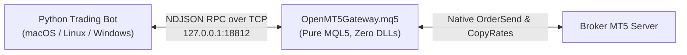

# OpenMT5Gateway

**Open-source, zero-DLL MetaTrader 5 bridge for macOS, Linux, and Windows.**

> Run Python trading bots against **MetaTrader 5** natively on **macOS** (Apple Silicon / Intel), **Linux**, Docker, or Windows — without MetaQuotes' Windows-only Python wheel, without C++ `.dll` injection, and without paid cloud proxies.

---

## Why This Exists

- MetaQuotes publishes `pip install MetaTrader5` **exclusively for Windows** — installing it on macOS or Linux fails (`No matching distribution found for MetaTrader5`).
- C++ DLL socket bridges break inside macOS/Linux Wine wrappers.
- MQL5 natively supports outbound client TCP sockets (`SocketCreate`, `SocketConnect`, `SocketSend`, `SocketRead`). **OpenMT5Gateway** flips the direction: **Python runs a lightweight, token-authenticated TCP server**, and a pure-MQL5 Expert Advisor connects outward from inside MT5.



---

## Features

- **Zero External Runtime Dependencies:** Uses Python stdlib only (`socket`, `threading`, `json`, `hmac`, `decimal`).
- **Token Authentication:** Constant-time `hmac.compare_digest` verification (`AUTH` / `AUTH_ACK`).
- **Correlated RPC Multiplexing:** Concurrent commands safely matched by `request_id`.
- **Idempotent Execution:** Duplicate `external_id` orders are blocked automatically.
- **Automatic Broker Suffix Resolution:** Resolves symbols like `EURUSD`, `EURUSD.a`, `EURUSDm`, `EURUSD.raw`, `EURUSD_pro`.
- **Filling-Mode Fallback in MQL5:** Automatically retries `IOC` -> `FOK` -> `RETURN`.
- **Live Telemetry & Reconciliation:** Streams balance/equity snapshots and pulls historical closed deals.

---

## Installation & Quickstart

### 1. Install Python Package
```bash
pip install -e .
```

### 2. Test Locally Right Now (Simulated Demo EA)
```bash
python -m open_mt5_gateway.cli \
  --port 18812 \
  --token "local-dev-secret" \
  --simulate-demo \
  --symbols EURUSD GBPUSD XAUUSD
```

### 3. Connect Real MetaTrader 5 (macOS / Windows)
1. Copy [`mql5/OpenMT5Gateway.mq5`](./mql5/OpenMT5Gateway.mq5) into your MT5 Data Folder under `MQL5/Experts/`.
2. Compile in MetaEditor (`0 errors`).
3. Enable **Allow Algorithmic Trading** in MT5 (`Tools -> Options -> Expert Advisors`).
4. Start your Python gateway, then attach `OpenMT5Gateway` onto any MT5 chart with matching `InpPort` and `InpAuthToken`.

```python
from decimal import Decimal
from open_mt5_gateway import GatewayConfig, OpenMT5Client, OpenMT5GatewayServer, OrderRequest

with OpenMT5GatewayServer(GatewayConfig(port=18812, auth_token="my-secret")) as gw:
    gw.wait_for_connection(timeout=30.0)
    client = OpenMT5Client(gw)

    acct = client.get_account()
    print(acct.login, acct.balance)

    res = client.submit_order(
        OrderRequest(
            external_id="trade-001",
            symbol="EURUSD",
            side="buy",
            volume=Decimal("0.10"),
            stop_loss=Decimal("1.08200"),
            take_profit=Decimal("1.08900"),
        )
    )
    print(res)
```

---

## Publishing to GitHub & PyPI

```bash
# Push to GitHub
gh repo create open-mt5-gateway --public --source=. --push

# Build & publish to PyPI
pip install build twine
python -m build
twine upload dist/*
```

## License

MIT License — see [LICENSE](./LICENSE).
