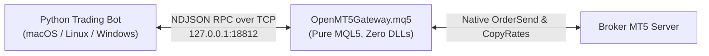

# OpenMT5Gateway

[](https://pypi.org/project/open-mt5-gateway/)
[](https://pypi.org/project/open-mt5-gateway/)
[](https://github.com/basharat78/open-mt5-gateway/actions)
[](https://github.com/basharat78/open-mt5-gateway/blob/main/LICENSE)

**Open-source, zero-DLL MetaTrader 5 bridge for macOS, Linux, and Windows.**

> Run Python trading bots against **MetaTrader 5** natively on **macOS** (Apple Silicon / Intel), **Linux**, Docker, or Windows — without MetaQuotes' Windows-only Python wheel, without C++ `.dll` injection, and without paid cloud proxies.

---

## Why This Exists

- MetaQuotes publishes `pip install MetaTrader5` **exclusively for Windows** — installing it on macOS or Linux fails (`No matching distribution found for MetaTrader5`).
- C++ DLL socket bridges break inside macOS/Linux Wine wrappers.
- MQL5 natively supports outbound client TCP sockets (`SocketCreate`, `SocketConnect`, `SocketSend`, `SocketRead`). **OpenMT5Gateway** flips the direction: **Python runs a lightweight, token-authenticated TCP server**, and a pure-MQL5 Expert Advisor connects outward from inside MT5.



---

## Features

- **Zero External Runtime Dependencies:** Uses Python stdlib only (`socket`, `threading`, `json`, `hmac`, `decimal`).
- **Token Authentication:** Constant-time `hmac.compare_digest` verification (`AUTH` / `AUTH_ACK`).
- **Correlated RPC Multiplexing:** Concurrent commands safely matched by `request_id`.
- **Idempotent Execution:** Duplicate `external_id` orders are blocked automatically.
- **Automatic Broker Suffix Resolution:** Resolves symbols like `EURUSD`, `EURUSD.a`, `EURUSDm`, `EURUSD.raw`, `EURUSD_pro`.
- **Filling-Mode Fallback in MQL5:** Automatically retries `IOC` -> `FOK` -> `RETURN`.
- **Live Telemetry & Reconciliation:** Streams balance/equity snapshots and pulls historical closed deals.

---

## Installation & Quickstart

### 1. Install Python Package

Install directly from [PyPI](https://pypi.org/project/open-mt5-gateway/):

```bash
pip install open-mt5-gateway
```

With optional `pandas` DataFrame support:

```bash
pip install "open-mt5-gateway[dataframe]"
```

Or install editable from a local source checkout:

```bash
pip install -e .
```

### 2. Test Locally Right Now (Simulated Demo EA)

Run the installed pre-flight diagnostic CLI with the built-in simulated demo EA:

```bash
open-mt5-preflight \
  --port 18812 \
  --token "local-dev-secret" \
  --simulate-demo \
  --symbols EURUSD GBPUSD XAUUSD
```

*(Or run via module: `python -m open_mt5_gateway.cli --port 18812 --token "local-dev-secret" --simulate-demo --symbols EURUSD GBPUSD XAUUSD`)*

### 3. Connect Real MetaTrader 5 (macOS / Windows)

1. Copy [`mql5/OpenMT5Gateway.mq5`](https://github.com/basharat78/open-mt5-gateway/blob/main/mql5/OpenMT5Gateway.mq5) into your MT5 Data Folder under `MQL5/Experts/`.
2. Compile in MetaEditor (`0 errors`).
3. Enable **Allow Algorithmic Trading** in MT5 (`Tools -> Options -> Expert Advisors`).
4. Start your Python gateway, then attach `OpenMT5Gateway` onto any MT5 chart with matching `InpPort` and `InpAuthToken`.

```python
from decimal import Decimal
from open_mt5_gateway import GatewayConfig, OpenMT5Client, OpenMT5GatewayServer, OrderRequest

with OpenMT5GatewayServer(GatewayConfig(port=18812, auth_token="my-secret")) as gw:
    gw.wait_for_connection(timeout=30.0)
    client = OpenMT5Client(gw)

    acct = client.get_account()
    print(acct.login, acct.balance)

    res = client.submit_order(
        OrderRequest(
            external_id="trade-001",
            symbol="EURUSD",
            side="buy",
            volume=Decimal("0.10"),
            stop_loss=Decimal("1.08200"),
            take_profit=Decimal("1.08900"),
        )
    )
    print(res)
```

---

## Supported NDJSON RPC Actions

All frames are newline-delimited UTF-8 JSON objects (`AUTH`, `AUTH_ACK`, `TELEMETRY`, `COMMAND`, `RESPONSE`).

| Action | Python Method (`OpenMT5Client`) | Description |
| :--- | :--- | :--- |
| `PING` | `ping()` | Connectivity heartbeat check between Python and the MQL5 EA. |
| `GET_ACCOUNT` | `get_account()` | Fetches account login, broker server name, balance, equity, and UTC server timestamp. |
| `GET_SYMBOL_SPEC` | `get_symbol_spec(symbol)` | Resolves broker symbol suffixes and returns bid/ask, point, digits, volume limits, and `trade_allowed`. |
| `GET_RATES` | `get_rates(symbol, timeframe, count)` | Fetches OHLCV bar dicts (`time`, `open`, `high`, `low`, `close`, `volume`). |
| `ORDER_SEND` | `submit_order(request)` | Submits a market order with `external_id` deduplication and automatic `IOC` -> `FOK` -> `RETURN` fallback. |
| `ORDER_MODIFY` | `modify_position(...)` | Updates stop-loss and take-profit levels on an open broker ticket. |
| `POSITION_CLOSE_PARTIAL` | `close_partial(broker_ticket, volume)` | Partially closes an open position by lot volume. |
| `CLOSE_ALL` | `close_all(reason)` | Closes all open positions matching the configured `magic_number`. |
| `GET_CLOSED_DEALS` | `get_closed_deals(since_timestamp)` | Fetches closed deal history (profit, commission, swap, prices, timestamps) for reconciliation. |

---

## Development & Testing

```bash
git clone https://github.com/basharat78/open-mt5-gateway.git
cd open-mt5-gateway
pip install -e ".[dev]"
pytest -v
```

---

## License

MIT License — see [LICENSE](https://github.com/basharat78/open-mt5-gateway/blob/main/LICENSE).
